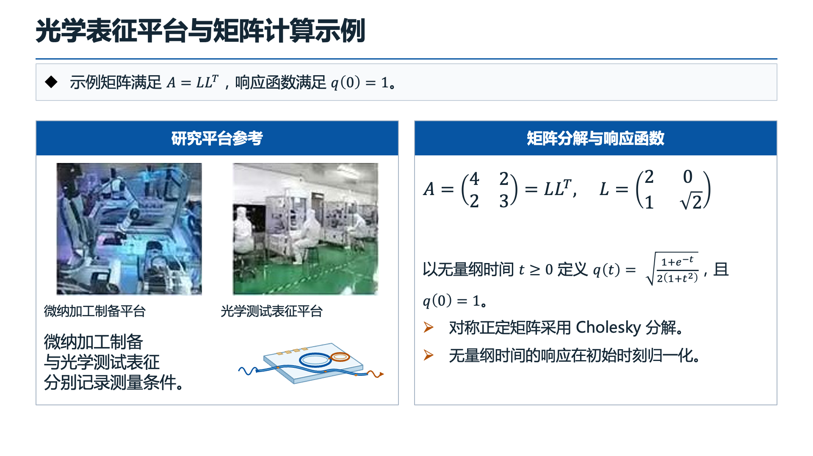
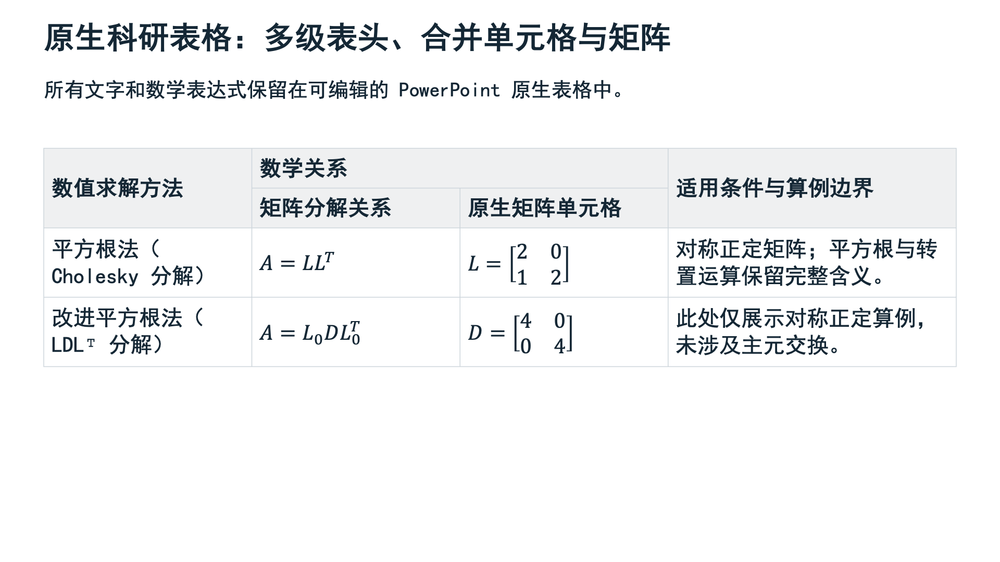

# Total-pipe v3

从论文证据和科研叙事生成可编辑 PowerPoint 的模块化流水线。Agent 按 Skill 调度各组件，
RPA 规划内容结构，Deck Compiler 确定最终几何并检查容量，OfficeCLI 写入原生 PPTX。

**默认入口：** [total-pipe-agent Skill](Total-pipe/skills/total-pipe-agent/SKILL.md) 与四工具接入层。
**完整流程规范：** [total-pipe-deck Skill](Total-pipe/skills/total-pipe-deck/SKILL.md)。
**操作手册：** [中文使用说明](Total-pipe/docs/USAGE.zh-CN.md)。
**环境与安装：** [环境清单](Total-pipe/环境清单.md)。
**按任务查文档：** [当前文档索引](docs/README.md)；Agent 阅读规则见 [AGENTS.md](AGENTS.md)。

## 生成效果

以下为实际生成的 PPTX 经 Microsoft PowerPoint 原生导出的幻灯片画面，均为软件功能示例。

**复杂科研混排：参考图片、测量边框、原生列表、矩阵、行内公式与可编辑 Bézier 图形。**



[下载可编辑 PPTX](Total-pipe/examples/complex-mixed/complex-mixed.pptx) · [源 IR 与重建说明](Total-pipe/examples/complex-mixed/README.zh-CN.md)

**原生科研表格：多级表头、跨行跨列、公式格与矩阵。**



[表格源 IR](Total-pipe/examples/native-table.deck_ir.json) · [展示图来源与隐私检查](docs/images/README.md)

## 当前版本

以下为当前仓库声明的版本，核对日期为 **2026-10-25**。产品、组件与文件协议分别版本化；
复合布局、原生科研表格和行内公式已在当前源码中实现。

| 对象 | 当前声明 | 版本来源 |
| --- | --- | --- |
| Total-pipe 插件 | `3.3.0+codex.20261021203000` | [插件清单](Total-pipe/.codex-plugin/plugin.json) |
| Agent 接入层 / 默认 MCP | `1.0.0`；四工具 | [接入层](Total-pipe/agent/__init__.py)、[实施修订](Total-pipe/docs/agent-adapter-design.md) |
| Total-pipe 低层 MCP / Deck Compiler Python 模块 | `3.2.0` / `2.3.1` | [MCP 服务](Total-pipe/deck_compiler/mcp_server.py)、[模块版本](Total-pipe/deck_compiler/__init__.py) |
| PaperWorkflow 插件 / MCP / Python 项目 | `0.2.0+codex.20260928131752` / `0.3.0` / `0.1.0` | [插件清单](PaperWorkflow/.codex-plugin/plugin.json)、[MCP 服务](PaperWorkflow/mcp_server.py)、[pyproject.toml](PaperWorkflow/pyproject.toml) |
| pwf2rpa | `1.4.0` | [模块版本](Total-pipe/pwf2rpa/pwf2rpa/__init__.py) |
| Research PPT Assistant | `0.6.3-rc1`；插件构建 `0.6.3-rc1+codex.20260920125419` | [package.json](research-ppt-assistant/package.json)、[插件清单](research-ppt-assistant/.codex-plugin/plugin.json) |
| 文件协议 | PaperWorkflow schema `4`；Deck IR `2.0`；layout tree `1.0` / `1.1` / `1.2` | [工作流实现](PaperWorkflow/utils/literature_workflow.py)、[Deck IR Schema](Total-pipe/schemas/deck-ir.schema.json) |

仓库现有版本元数据尚未统一，服务握手可能返回上表中的组件版本。部署时同时记录 Git commit，
并查询 `python -m deck_compiler capabilities` 确认功能；插件版本号不能代替运行时能力检查。

## 实际组件与职责

| 组件 | 位置 / 入口 | 负责的内容与产物 |
| --- | --- | --- |
| 总调度 Skill | [Total-pipe/skills/total-pipe-deck/](Total-pipe/skills/total-pipe-deck/SKILL.md) | 调度证据、Story、RPA、Design、编译与验收；组织失败后的修订 |
| Agent 接入层 | [Total-pipe/agent/](Total-pipe/agent/)、[轻量 Skill](Total-pipe/skills/total-pipe-agent/SKILL.md) | 以现有组件推进阶段、准备完整提示、验证与恢复 job；不编写科学内容 |
| PaperWorkflow（PWF） | [PaperWorkflow/](PaperWorkflow/README.md)；`mcp_server.py` | PDF OCR / Markdown 接入、证据检索、图片与尺寸元数据；产出 `workflow.json`、`evidence.md` 和可搬移资源包 |
| Story Planner | Skill 调度的独立 Agent 阶段；[提示包接口](Total-pipe/pwf2rpa/pwf2rpa/story.py) | 依据证据组织 `question / answer / evidence / next` 和可选 `key_points`，产出 `story_plan.json` |
| pwf2rpa | [Total-pipe/pwf2rpa/](Total-pipe/pwf2rpa/README.md) | 确定性校验、内容与元数据传输；把 Story 转成 RPA 输入，产出 `rpa_input.json` |
| Research PPT Assistant（RPA） | [research-ppt-assistant/](research-ppt-assistant/README.md) | 规范化内容、选择整页版式和子布局、绑定原文、验证规划；提供 320 个版式、40 类语义和 16 套主题 |
| Scientific Visual Planner | 当前 Agent 的 Design 阶段；[协议](Total-pipe/docs/scientific-visual-planner.md) | 选择整套科研风格及支持页面的视觉构图，生成提案并合入 Deck IR 的 `presentation` |
| Deck Compiler / Deck IR | [Total-pipe/deck_compiler/](Total-pipe/README.md) | 校验科学内容契约、递归分配区域、测量文本与公式、检查几何，生成确定坐标及 `layout_feedback.json` / `qa_report.json` |
| 布局提供方 | [totalpipe_layout/](Total-pipe/totalpipe_layout/)、[提供方接口](Total-pipe/docs/layout-provider.md) | 内置 `packer` 为受支持的平面正文提供确定性几何建议；复杂测量页由编译器布局，单独记录 owned；也可选 `compiler` 或外部 `module:factory` |
| OfficeCLI | 外部安装的命令行程序 | 按编译结果写入文字、图片、原生公式、表格、流程图、连接符与贝塞尔路径等 PowerPoint 对象 |
| Microsoft PowerPoint | macOS / Windows 桌面程序 | 逐页检查实际排版并导出原生 PDF，供正式交付验收 |

Story Planner 和 Scientific Visual Planner 是 Agent 工作阶段；提示包工具本身只准备输入和校验结果。
可选的 DesignIntentPlanner 在 Story 后声明四步流程关系，详见使用说明；它不替代整套 Design。

## 完整流程与入口

```text
论文 PDF / Markdown
  → PaperWorkflow：workflow.json + evidence.md + 原图
  → Story Planner：story_plan.json
  → [可选 DesignIntentPlanner：design_intent.json]
  → pwf2rpa：rpa_input.json
  → RPA：内容规范化、版式 / 子布局规划、原文绑定验证
  → Agent 按 Schema 映射 canonical deck_ir.json
  → Scientific Visual Planner：整套 Design 提案 → 合入后的 Deck IR
  → Deck Compiler + 布局提供方：几何、容量和结构化反馈
  → OfficeCLI：candidate.pptx / staging.pptx + QA
  → 需要正式 final 时：PowerPoint 逐页验收 + 原生 PDF + REVIEW 审核 → promote
```

### 1. 从论文开始：Agent + Skill

在完整仓库根目录执行 `python3.12 install.py --client codex`（Claude 使用 `--client claude`），
默认注册 `total_pipe`，只暴露 doctor / start / advance / status 四工具。
使用 [total-pipe-agent Skill](Total-pipe/skills/total-pipe-agent/SKILL.md)，按 next_action 提供 Agent 产物与用户选择。
已有 IR / workflow 可从对应阶段继续；安装、状态与恢复详见[接入层说明](Total-pipe/docs/agent-adapter.md)。例如：

```text
使用 total-pipe-agent，将 /absolute/path/paper.pdf 制作为中文研究汇报。
围绕研究问题、方法、关键结果和局限组织证据与故事，完成整套 Design。
保留完整科学术语、原图和原生公式，交付可编辑候选及 QA 报告。
```

Story 阶段需要记录用户选择的模型、reasoning 和真实 subagent provenance。
从已有证据、Story 或 Deck IR 继续时，按产物状态进入相应阶段。
RPA 计划到 canonical Deck IR 的语义映射由 Agent 按 Schema 完成。

### 2. 已有 Deck IR：编译 CLI

下面的命令均在 `<repo>/Total-pipe/` 运行：

```bash
# 查询协议与原生对象能力
python -m deck_compiler capabilities

# 准备完整 Design 提示包；Agent 阅读后编写 visual_proposal.json
python -m deck_compiler visual-prompt --ir deck_ir.json --out visual_prompt.json
python -m deck_compiler apply-visual-plan --ir deck_ir.json \
  --proposal visual_proposal.json --out designed.deck_ir.json

# 只编译布局和 QA
python -m deck_compiler compile --ir designed.deck_ir.json --out build/my-deck

# 生成可编辑候选，开发阶段暂不导出 PowerPoint PDF
python -m deck_compiler build --ir designed.deck_ir.json --out build/my-deck \
  --officecli officecli --skip-native
```

有相对资源路径时，合入设计后的 IR 与源 IR 保存在同一目录。已包含完整设计的 IR 可直接编译。
`python totalpipe.py generate designed.deck_ir.json --out build/my-deck` 是同一编译阶段的简化入口，
输入同样是已有 Deck IR。漏做 Design 时，默认返回 `VISUAL_DESIGN_REQUIRED` 及完整提示包。

普通生成任务交付候选并报告未解决项；正式 `final.pptx` 还须完成
[PowerPoint 原生验收与晋级](Total-pipe/docs/USAGE.zh-CN.md#6-正式-finalpowerpoint-验收与晋级)。
`--skip-native` 的构建须补做原生验收后才能晋级。

### 3. MCP 服务入口

默认服务在 `<repo>/Total-pipe` 执行 `python -m agent.mcp_server`，配置为
[Total-pipe/.mcp.json](Total-pipe/.mcp.json)。原低层三服务保留在
[.mcp.advanced.json](Total-pipe/.mcp.advanced.json)，用 `install.py --profile advanced` 注册，
以下是各低层服务的独立启动方式：

| 服务 | 服务进程的工作目录 | 启动命令 | 配置 |
| --- | --- | --- | --- |
| `paperworkflow` | `<repo>/PaperWorkflow` | `python mcp_server.py` | [PaperWorkflow/.mcp.json](PaperWorkflow/.mcp.json) |
| `research_ppt` | `<repo>/research-ppt-assistant` | `node server/mcp-server.mjs` | [research-ppt-assistant/.mcp.json](research-ppt-assistant/.mcp.json) |
| `total_pipe_v3` | `<repo>/Total-pipe` | `python -m deck_compiler.mcp_server` | [Total-pipe/.mcp.advanced.json](Total-pipe/.mcp.advanced.json) |

advanced 客户端将相对 cwd 解析到对应组件目录；手动配置时填写实际绝对路径，
Python 指向已安装依赖的虚拟环境。Total-pipe 服务包含 pwf2rpa 的五个工具，以及
`totalpipe_capabilities / totalpipe_visual_prompt / totalpipe_apply_visual_plan / totalpipe_compile / totalpipe_build / totalpipe_review`，
以及候选复审工具 `totalpipe_qa / totalpipe_ack_review`。
MCP 文件参数使用绝对路径。更新源码后重载服务。

## 环境需求

| 环境 / 依赖 | 要求与适用阶段 |
| --- | --- |
| Python | **完整流水线使用 3.12+**，来自 PaperWorkflow 的 `requires-python`；在虚拟环境安装依赖 |
| Node.js | **22+**，用于 RPA；当前 RPA 运行时无第三方 npm 依赖 |
| 编译器 Python 依赖 | `Pillow>=10`、`lxml>=5`、`pdfplumber>=0.11`，见 [requirements.txt](Total-pipe/requirements.txt) |
| PaperWorkflow Python 依赖 | 以 [pyproject.toml](PaperWorkflow/pyproject.toml) 为准；完整 PDF / 批处理环境需安装其声明的依赖 |
| OfficeCLI | **1.0.152+** 可执行文件；生成 PPTX 时还检查所需对象属性 Schema。放入 PATH 或传 `--officecli` 绝对路径 |
| OCR | PDF 输入默认调用 **MinerU 官方 `mineru-open-api` CLI**，需安装并认证；已有 Markdown / 证据包可从对应阶段继续 |
| 字体 | 安装主题所需字体、使用语言的字形和 PowerPoint 数学字体；公式使用 Cambria Math。额外字体目录用 `TOTALPIPE_FONT_DIR` 指定 |
| 原生验收 | **macOS 或 Windows + Microsoft PowerPoint**；Linux / WSL 可执行规划、编译和结构检查，正式晋级还需 PowerPoint 原生证据 |
| 可选测量依赖 | `matplotlib` 提供数学字体度量；未安装或遇到不支持的数学结构时使用保守估计并保留 REVIEW。无需本地 LaTeX 或 torch |
| 模型与网络 | Story / Design 使用 Agent 模型；默认 MinerU 云 OCR 需要网络与认证。仅从本地 Deck IR 编译不要求模型 API Key |

最小编译环境与完整依赖安装命令见 [环境清单](Total-pipe/环境清单.md)。
`PAPERWORKFLOW_CONFIG` 可指向外部 YAML；`MINERU_TOKEN` 用于 OCR 认证。
旧批处理若调用 DeepSeek / OpenAI 兼容 API，还需对应密钥；MCP 的证据检索和编译器不要求这些密钥。
主题字体先从 IR 所在目录、额外字体目录及系统字体目录解析；替代字体会进入 QA。

## 当前能力与容量规则

可直接打开[复杂混排单页 PPTX](Total-pipe/examples/complex-mixed/complex-mixed.pptx)，
对应 [Deck IR、资源与重建说明](Total-pipe/examples/complex-mixed/README.zh-CN.md) 一并版本管理。
该样例同时展示参考图片、测量边框、原生项目符号、矩阵、行内根式 / 指数以及原生 Bézier 光子芯片图案。

- **原生数学内容**：分式、根号、上下标、嵌套指数、六种矩阵环境；密集多步推导按实际单双栏区域测量。
- **显式行内公式**：正文、标题 / takeaway、表格文字格可选开启；文字与数学片段按逐行宽度、上伸和下伸高度计算容量。图注、图形标签和 panel 标题暂不解析行内公式。
- **复合区域与表格**：`columns / stack / panel / image_grid` 递归布局；layout tree `1.1` 增加原生表格，含合并表头、跨行跨列和公式格；保留旧平面 IR 与 `1.0` 树。
- **原生科研图形**：流程、DAG、机制、分层架构、漏斗和贝塞尔路径；`process` 支持横向、纵向、错位和 3–8 步全方形紧凑布局，节点可单独强调；关系由上游显式声明，编译器分配区域。
- **原生列表**：整套或 block 独立设置符号样式与颜色，takeaway 可单独加前导标记；最低宽度 520 CSS px，高度按完整条目实测，术语保留策略不删除项目符号。见 [列表协议](Total-pipe/docs/native-lists.md)。
- **讲解契约**：Story 的 `explain` 逐条绑定证据，声明读者必须看见的量、并列项、分组、对照、顺序、关系或示意曲线；IR 带进 `semantic.explanation`，编译生成 `derived/explanation_coverage.json`。required 义务缺原生载体时保留 REVIEW，不静默当纯文字页。见 [讲解契约](docs/explanation-contract.md)。
- **图片来源**：区分论文图 `paper`、自绘示意图 `generated` 和用户参考裁图 `reference`；参考裁图保留 `reference_source`，不要求论文图号或“示意图”图注。见 [来源协议](Total-pipe/docs/deck-compiler-v2.md#figure-provenance-paper-generated-and-reference-images)。
- **可测量边框容器**：layout tree `1.2` 为 panel 增加原生边框与标题色带；takeaway 可独立框选。描边、内边距和完整内容参与容量计算，支持嵌套并保留旧树。见 [容器协议](Total-pipe/docs/framed-containers.md)。
- **可追溯反馈**：`layout_feedback.json` 给出组件路径、所需 / 可用尺寸与建议，供上游用完整内容重规划。
- **复杂页复审**：stack 保留默认贴合内容，可显式居中或分配余量，留白超过 15% 时给出 REVIEW 与相对权重建议；候选支持逐项签收和待复核视图，内容 / 几何变化后相关记录失效。见[复杂页 QA](Total-pipe/docs/complex-page-qa.md)。
- **科学术语优先**：`preserve-terms` 保留长标题与正文，超预算可带 REVIEW 生成候选；公式真实宽高、图形可读性和原图尺寸仍执行容量门禁。

编译阶段只维护 canonical Deck IR；`layout.json`、`derived/` 和后端 batch 都由编译器派生。
OfficeCLI 的 `Text overflow` 警告估计在 QA 中记为 INFO，保留原始 issue，再以实际 PowerPoint 页面核对。
正式晋级要求零 FAIL、当前文件绑定的原生验收，以及全部 REVIEW 的真实审核记录。

## 文档导航

| 文档 | 内容 |
| --- | --- |
| [中文使用说明](Total-pipe/docs/USAGE.zh-CN.md) | 从证据到候选 / final 的完整操作、门禁和修订流程 |
| [Agent 接入层](Total-pipe/docs/agent-adapter.md) / [修订设计](Total-pipe/docs/agent-adapter-design.md) | 默认四工具、安装、恢复、实际组件契约与设计评审 |
| [环境清单](Total-pipe/环境清单.md) | 安装、配置、平台范围与服务启动 |
| [编译器入口](Total-pipe/README.md) | Deck IR 编译命令与产物 |
| [Scientific Visual Planner](Total-pipe/docs/scientific-visual-planner.md) | 必做 Design、视觉提案及术语容量策略 |
| [讲解契约](docs/explanation-contract.md) | Story 可见结构、IR 义务、覆盖账本与责任边界 |
| [复合区域](Total-pipe/docs/composite-layouts.md) / [原生表格](Total-pipe/docs/native-tables.md) | 子布局规划、递归几何与尺寸反馈 |
| [行内公式](Total-pipe/docs/inline-math.md) / [Deck IR 协议](Total-pipe/docs/deck-compiler-v2.md) | 数学语法、混排测量和完整 IR 约束 |
| [原生图形](Total-pipe/docs/native-graphics.md) / [科研组件与路径](Total-pipe/docs/native-components.md) | 可编辑流程、机制、架构与贝塞尔图形 |
| [开发后文档同步 Skill](Total-pipe/skills/total-pipe-doc-sync/SKILL.md) | 开发收尾时核对 README、中文用法、环境与协议，提交前清理过时说明 |

过时开发总结、旧 Agent 指南、v26 实验和旧发布清单已统一移入[历史归档](docs/archive/README.md)，
保留原文和原路径索引；默认检索不包含归档。安装和运行以本 README、当前使用说明及源码为准。
