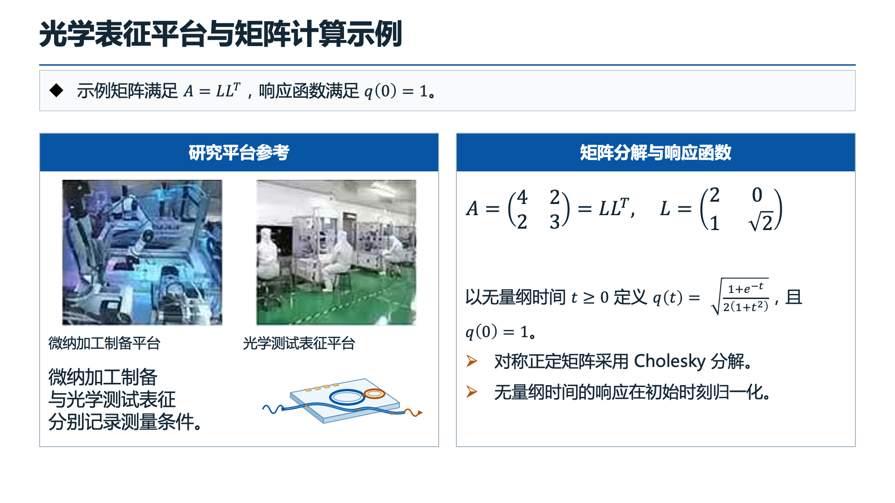
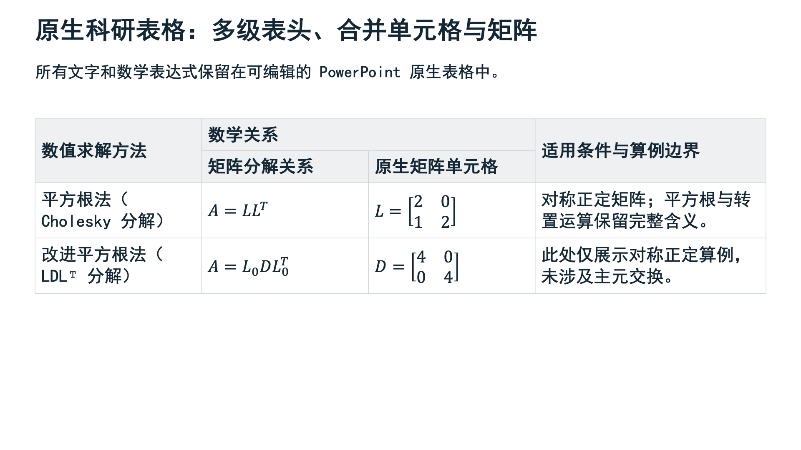
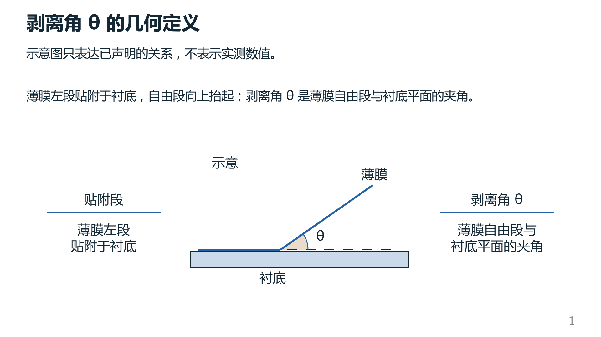
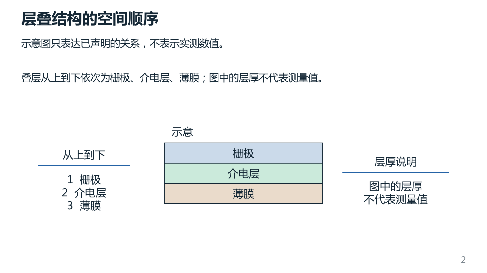
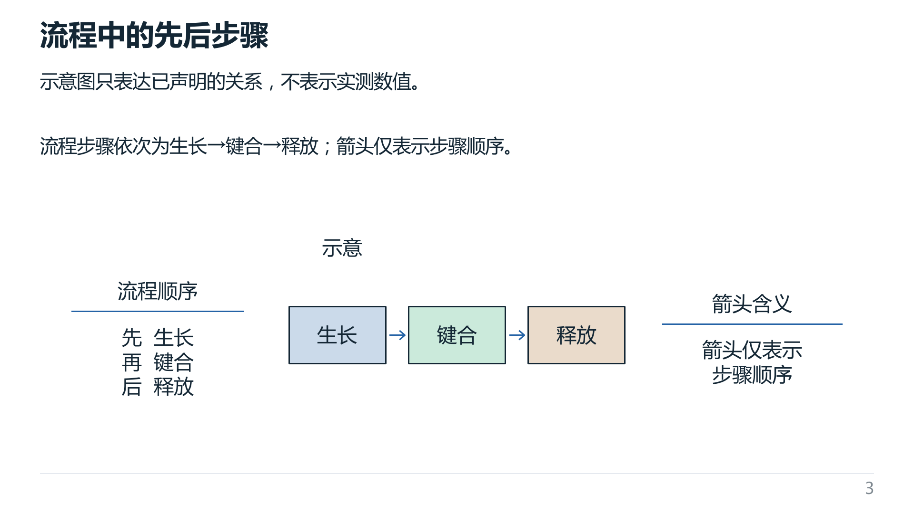

# Total-pipe v3

**把论文做成可编辑的科研 PowerPoint。**

Total-pipe 面向组会、文献分享和答辩。给它一篇论文、听众和汇报时长，它会围绕研究问题、方法、关键证据和结论边界组织一套幻灯片。你可以从 PDF 或 Markdown 开始，也可以接着已有的证据包或演示草稿继续做。

[开始使用](#开始使用) · [看样例](#生成效果) · [AI 工程索引](docs/README.md)

## 生成效果

下面的幻灯片从 PowerPoint 导出。同一页里有设备参考图、矩阵推导、可编辑公式和芯片示意图。



[下载这页 PPTX](Total-pipe/examples/complex-mixed/complex-mixed.pptx) · [样例素材与制作说明](Total-pipe/examples/complex-mixed/README.zh-CN.md)

### 更多幻灯片

点击缩略图可看全尺寸。剥离角、层叠结构和工艺流程三页使用构造示例，图形和标注都可以在 PowerPoint 里编辑。

| 科研表格 | 剥离角示意 |
| --- | --- |
| [](docs/images/native-table.png) | [](Total-pipe/examples/explain-viz/whitespace-filled/slide-1.png) |
| **层叠结构** | **工艺流程** |
| [](Total-pipe/examples/explain-viz/whitespace-filled/slide-2.png) | [](Total-pipe/examples/explain-viz/whitespace-filled/slide-3.png) |

[下载三页示意图 PPTX](Total-pipe/examples/explain-viz/whitespace-filled/filled.pptx) · [查看展示图来源](docs/images/README.md)

## 你会拿到什么

- **可编辑的 PPTX 候选。** 可以在 PowerPoint 里继续修改文字、公式、表格和自绘图形，也可以替换论文原图。
- **可回查的证据。** 关键结论、数值和论文图保留来源，方便准备讲稿和回答提问。
- **质量检查报告。** 报告指出需要修订或复核的页面。正式版还需在 PowerPoint 中逐页验收。

## 开始使用

以 Codex 为例，在仓库根目录运行以下命令。

```sh
python3 install.py --client codex
```

同一个安装器也支持 Claude Code、WorkBuddy、OpenCode、Gemini CLI 和 DeepSeek Harness。查看对应的宿主 ID、环境要求，以及处理 PDF 所需的 MinerU 设置。[安装指南](INSTALL_FOR_AI.md) · [环境清单](Total-pipe/环境清单.md)

安装后，在 AI 宿主里交代论文、听众和汇报重点。可以直接改用下面这段请求。

> 使用 total-pipe-agent，把 `/path/to/paper.pdf` 做成一份 20 分钟的中文组会汇报。听众有本领域基础，但没读过论文。请讲清作者要解决什么问题、方法为什么有效、哪些图表支持结论，以及结论适用于什么条件。交付可编辑 PPTX 候选和检查报告。

## 继续阅读

- [快速开始](QUICKSTART.md)涵盖从论文或已有演示草稿开始的操作。
- [中文使用说明](Total-pipe/docs/USAGE.zh-CN.md)涵盖制作、修订和 PowerPoint 验收。
- [AI 工程索引](docs/README.md)按任务查组件、接口、协议、版本来源及可运行样例。
