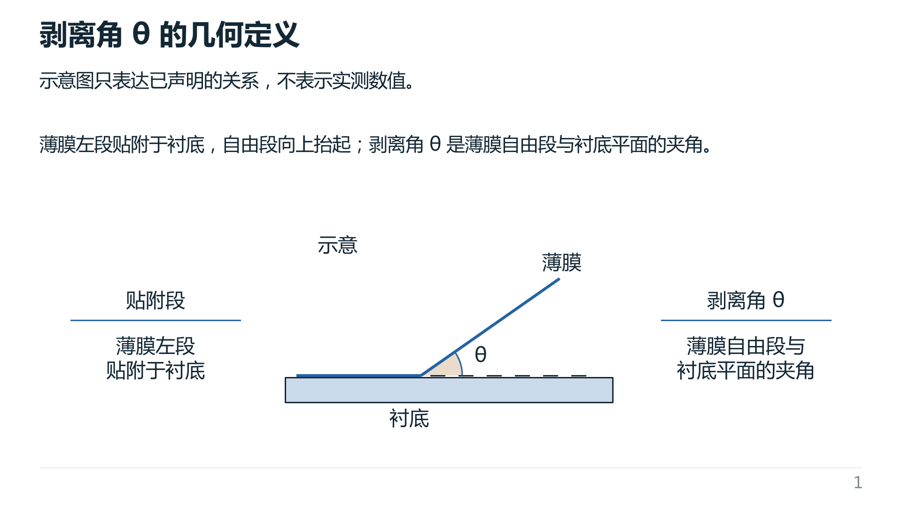
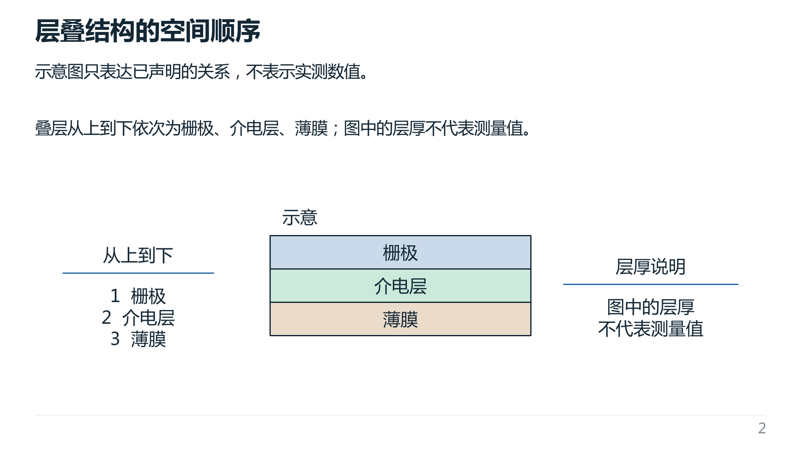
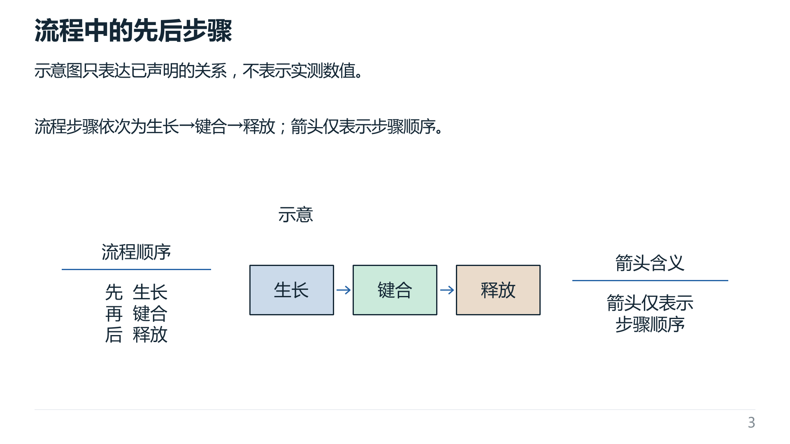

# 三页空白检测与讲解标注样例

本例在已着色的剥离角、层叠结构和流程三页中，检测图示两侧空白并加入六处读图标注。
文字为软件开发用的构造事实，不对应真实论文或实验。三页均使用可编辑的原生形状和文字。

- [可编辑 PPTX](filled.pptx)；[PowerPoint 原生 PDF](native.pdf)。
- [填充后 Deck IR](filled.deck_ir.json)；[填充前 Deck IR](source.deck_ir.json)。
- [检测与放置审计](blank-fill.audit.json)；[原生导出及文件哈希](export-evidence.json)。

这是使用现有 `deck_compiler.explain_viz.space.empty_rectangles` 的一次性成品编辑：
最小空白为 240×160 CSS px，与原对象保留 12 px 间隔，纯背景预留路径不作为障碍。
根据检测结果，Agent 从各页正文选择贴附段、夹角、上下顺序、层厚限定及箭头含义等读图提示，
再将标注映射进原图的局部画布。六处标注共新增 18 个原生对象，所有新增对象均位于对应检测空白内。

已处理页的默认 ExplainViz 不会再次自动增强，本例的最终编译显式使用 off；
此样例不代表软件会自动替任意页面编写注释。既有正文、语义、布局树、原图配色和字体保持，
扩展局部画布后使用顶部对齐策略，避免正文因首选宽高比改变而重新居中。

## 重建

从 `Total-pipe/` 运行，需要当前编译器依赖、OfficeCLI 及示例使用的中文字体：

```bash
python -m deck_compiler build \
  --ir examples/explain-viz/whitespace-filled/filled.deck_ir.json \
  --out ../build/explain-viz-filled-example --explain-viz-mode off --skip-native
```

上面的命令从已记录的填充后 IR 重建可编辑候选；PPTX 的 ZIP 时间戳等元数据可能不同。
原生验收参照[操作手册](../../../docs/USAGE.zh-CN.md#6-正式-finalpowerpoint-验收与晋级)。

## 实际验证（2026-11-07）

按用户指定，由 gpt-6.1-terra / high 独立复核，并逐页查看 Microsoft PowerPoint 16.56
在 macOS 通过 AppleScript 原生导出的 PDF 页面：中文及标注可读，关系和顺序忠实，未见明显遮挡或裁切。
原生 PDF 文字检查返回空问题列表；导出输入副本与提交的 PPTX 字节 SHA-256 一致。

独立重新计算的空白区域与审计一致；所有原对象属性、字体与文字保持，最大边界差约
1.14×10⁻¹³ CSS px，为浮点表示误差。PPTX 三页分别有 27、19、23 个原生形状，无图片替代。
结构 QA 为 0 FAIL、0 WARNING、8 REVIEW、4 INFO，现有 REVIEW 保留。
本次未在 PowerPoint UI 中逐页操作对象，也未进行正式 final 晋级；成品编辑未重跑软件功能套件。

## PowerPoint 原生预览






